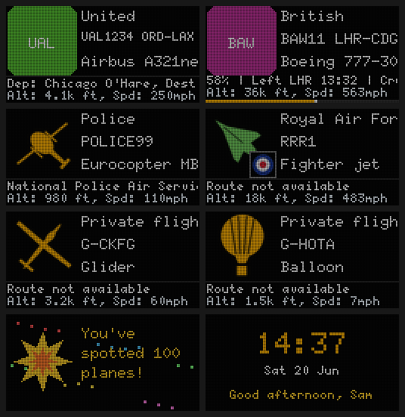

# Flight Board

A little LED sign that shows the aircraft flying over your house. It picks up the planes near you, works out who is flying them and where they're going, and shows it on a 128x64 LED panel, with a phone-friendly settings page. It runs on a Raspberry Pi, and you can try the whole thing on a Mac first.



*These pictures are drawn by the project's own code. The real panel shows airline logos where it has them, and you download those separately (see below).*

## What it does

- **Nearby aircraft:** logo, airline, flight number and route, aircraft type, departure and destination with an ETA, altitude and speed. It rotates through the nearest few, every 10, 20 or 30 seconds.
- **Track a flight:** type a flight number such as `BA11` and the board follows it from take-off to landing, with a progress bar along the bottom.
- **Knows what it's looking at:** helicopters, gliders, balloons, airships, drones, private jets, light planes and fighters each get their own icon. Military aircraft are green with an emblem, and police, coastguard and air ambulance helicopters are labelled.
- **Personal touches:** a greeting, "Good morning, Sam", birthday, Christmas, Mother's Day and Father's Day messages, gold alerts for rare aircraft like the A380, and a "You've spotted 100 planes!" milestone counter.
- **Easy to run:** settings page for location (a town name or postcode), brightness, units, night dimming, Wi-Fi and the above. It keeps running if the internet drops, and it restarts itself after a crash or power cut.
- **No API keys, no accounts.**

## What you need (per board)

- A 128x64 HUB75 LED panel, 2.5 mm pitch: either one 128x64 board or two 64x64 panels chained
- A Raspberry Pi (a Zero 2 W, 3A+ or 3B+ is ideal; a Pi 4 works but needs a higher GPIO slowdown)
- An Adafruit RGB Matrix Bonnet, with the GPIO 4 to 18 mod for flicker-free output
- A 5V 8-10A power supply (it can power both the panel and the Pi)
- A microSD card; optionally a diffuser and a frame

The hardware notes and the first power-up checks are further down.

## How it fits together

| Part | What it does |
| --- | --- |
| `flightboard/display.py` | The program that runs on the Pi: fetches aircraft, draws frames, drives the panel (or a browser simulator) |
| `flightboard/web.py` | The settings page (Flask) |
| `flightboard/render.py` | Draws every screen with Pillow, with no hardware needed |
| `flightboard/data.py`, `tracker.py` | Fetching aircraft and routes, and following a single flight |
| `flightboard/kinds.py`, `easter.py` | What kind of aircraft something is, and the personal touches |
| `deploy/`, `scripts/` | systemd services, install and cloning scripts for the Pi |
| `tests/` | Unit tests: `python3 -m unittest discover -s tests -t .` |

The display and the settings page are separate programs that share one `config.json`.

## Airline logos

Logos are the airlines' trademarks, so they are not in this repository. Download them once with `./scripts/fetch-logos.sh`. It pulls about 1,600 logos, named by ICAO airline code (`BAW.png`), from the public Jxck-S/airline-logos collection. `install.sh` runs it for you if the folder is empty. Anything without a logo gets a coloured tile with the airline code, and you can drop in your own `ICAO.png` any time.

## Try it on your Mac first

```
pip3 install -r requirements.txt
python3 preview.py                                   # sample frames -> out/contact-sheet.png
python3 preview.py --live --lat 51.5 --lon -0.12     # nearest real aircraft -> out/live.png
python3 -m flightboard.display --simulate --demo     # live view at http://localhost:8765, cycles samples
python3 -m flightboard.display --simulate            # same, with real aircraft from config.json
FLIGHTBOARD_PORT=8090 python3 -m flightboard.web     # settings page at http://localhost:8090 (8080 is often taken by Docker)
python3 -m unittest discover -s tests -t .           # tests
```

The simulator runs the same loop as the Pi. Config changes in the settings page apply live. Code changes need a restart (Ctrl-C and rerun). Layout lives in `flightboard/render.py`.

## Hardware notes

- Bonnet: bridge GPIO 4 to GPIO 18 (the "flicker-free" mod) and set the E-line jumper for 64-row panels. Without the 4-18 mod, change `hardware_mapping` in `config.json` from `adafruit-hat-pwm` to `adafruit-hat`.
- Power: 5V 8-10A supply wired straight to the panels (not through the Pi).
- If the image is garbled or flickers, raise `hardware.gpio_slowdown` (default 2) in `config.json`.
- `scripts/install.sh` disables onboard audio (the matrix library will not run with it loaded) and reserves CPU core 3 for the display.

## If the panel looks wrong (first power-up)

Run the test pattern on the Pi: `sudo systemctl stop flightboard-display && cd /opt/flightboard && sudo .venv/bin/python -m flightboard.display --test`. You should see a white border, TL/TR/BL/BR labels in the right corners, red/green/blue/white bars, a smooth grey ramp and a diagonal line. Then:

- **Single 128x64 board** (e.g. a P2.5 320x160mm module with HUB75E, 1/32 scan): the defaults (`rows 64`, `cols 64`, `chain_length 2`) normally work because it's electrically two 64x64 halves in series. If it doesn't, try `"cols": 128, "chain_length": 1`.
- **Flicker or garbage:** raise `hardware.gpio_slowdown` (Pi 3: 2-3, Pi 4: 3-4).
- **Wrong colours or all dark:** the driver chip may need an init sequence. Add `"panel_type": "FM6126A"` under `hardware` in `config.json`.
- **Rows or pixels scrambled or duplicated:** try `"multiplexing"` (a number 0-17) or `"row_address_type"` (0-4) under `hardware`. Change one at a time and restart.

These extras are passed straight to the matrix library, which only applies them if present.

## Build the master SD image (once)

1. Flash **Raspberry Pi OS Lite (Bookworm)** with Raspberry Pi Imager. In its settings: hostname `flightboard`, enable SSH, set a user/password, and set your own Wi-Fi so you can reach it.
2. Boot the Pi, SSH in, and copy this folder across (`scp -r flight-board pi@flightboard.local:~`).
3. `cd flight-board && sudo ./scripts/install.sh`, then `sudo reboot`.
4. Check it: the panels should show the boot screen with the hostname and IP, then `Set your location`. Open `http://flightboard.local`, type your town or postcode, save. Aircraft should appear within about 10 seconds if anything is overhead.
5. Logos: `install.sh` downloads them (see "Airline logos" above). To add or replace one, put an `ICAO.png` file (e.g. `BAW.png`) in `/opt/flightboard/logos/`.
6. When you're happy, run `sudo ./scripts/prepare-clone.sh`. It deletes the saved config, saved Wi-Fi networks and SSH host keys, resets the hostname, and shuts the Pi down.
7. Pull the SD card and make an image of it (e.g. `sudo dd if=/dev/diskN of=flightboard-master.img bs=4m` on a Mac, or Raspberry Pi Imager / balenaEtcher to write it back).

Use the smallest card you can for the master (8-16GB), so the image is quick to copy.

## Set up each recipient's unit

1. Write the master image to a new SD card.
2. Before first boot, give it the recipient's Wi-Fi: mount the card's boot partition and add the network (or boot it at home on your own Wi-Fi, SSH in with `ssh pi@flightboard.local`, and use `sudo nmcli device wifi connect "SSID" password "PASSWORD"`).
3. Give it a unique name so clones don't clash on `flightboard.local`:
   `sudo /opt/flightboard/scripts/set-hostname.sh flightboard-sam`
   It's then at `http://flightboard-sam.local`.
4. Open that address on a phone on the same Wi-Fi and set the recipient's town or postcode, units, brightness and night mode.

Tell the recipient: if the screen shows `Waiting for Wi-Fi...`, the Wi-Fi isn't right. If it shows an address after boot, that's where the settings page lives.

## Personal touches and flight tracking

On the settings page:

- **Personal touches:** a name and greeting, special dates (`03-14 Happy Birthday Sam!`, one per line), gold alerts for rare aircraft (you can add your own type codes or callsign starts), and milestone celebrations ("You've spotted 100 planes!" at 50, 100, 500, 1000, then every 1000). The count is kept in `state.json`.
- **Track a flight:** enter a flight number such as `BA11`. The board follows that one flight, with a progress bar on the bottom pixel rows, until about 20 minutes after it lands, then goes back to normal. Free data has no schedules, so "Left" is the time the board first saw the plane airborne near its origin, and ETA is an estimate from distance and speed. Over open ocean there is no signal, so the row shows "Signal lost" until it returns.

## How often the board changes aircraft

The settings page has Fast (10 s), Medium (20 s) and Slow (30 s). The default is Slow. A busy sky like London suits Fast, and somewhere quieter suits Slow. "Only the nearest aircraft" ignores this and stays on the closest plane.

## Settings

All in `config.json` (`/opt/flightboard/config.json` on the Pi), edited through the settings page. The display notices changes within a second. Not on the page, edit the file: `hardware.*`, `poll_secs`.

The Wi-Fi form on the settings page switches the board to a new network using NetworkManager. If the details are wrong the board can drop offline, and then it needs SSH or a screen and keyboard to recover. It's meant for moving house, not for experiments.

## Troubleshooting

- Logs: `journalctl -u flightboard-display -f` and `journalctl -u flightboard-web -f`
- Restart: `sudo systemctl restart flightboard-display flightboard-web`
- `No connection` in red: the board can't reach the APIs. It keeps retrying and recovers by itself.
- A small red dot top-right of the aircraft screen means the last few polls failed and the aircraft shown is old.
- Nothing shows for ages: widen the radius, or tick "Include aircraft on the ground".

## Notes

- The ETA is the straight-line distance to the destination at current ground speed, shown as a clock time in the board's local time. Treat it as a guide.
- Fonts in `flightboard/fonts/` are the X11 misc-fixed fonts (public domain), converted for Pillow with `scripts/make_fonts.py`.
- Airline logos belong to the airlines. They came from the public GitHub collection Jxck-S/airline-logos. Don't publish the `logos/` folder.

## Credits and data

- Aircraft positions: [adsb.lol](https://adsb.lol) and [adsb.fi](https://adsb.fi) open data (community ADS-B receivers)
- Routes, airlines and aircraft details: [adsbdb.com](https://www.adsbdb.com)
- Postcodes: [postcodes.io](https://postcodes.io)
- Place search: [OpenStreetMap](https://www.openstreetmap.org/copyright) Nominatim. Map data © OpenStreetMap contributors
- LED driving: [hzeller/rpi-rgb-led-matrix](https://github.com/hzeller/rpi-rgb-led-matrix) (used at run time on the Pi, not included here)
- Fonts: the X11 "misc-fixed" bitmap fonts by Markus Kuhn, which are in the public domain
- Airline logos: from the public [Jxck-S/airline-logos](https://github.com/Jxck-S/airline-logos) collection. They belong to the airlines, so they aren't in this repository.

Be kind to the free services: the board polls every few seconds and caches what it looks up. If you run a lot of boards, please keep it that way.

## Licence

The code is released under the [MIT licence](LICENSE). The airline logos and the data sources above have their own terms.
